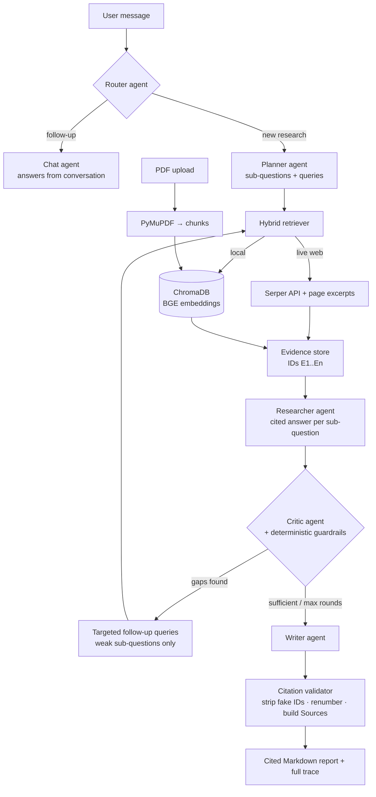

<div align="center">

# 🔬 ResearchCrew

### A multi-agent research system that critiques its own evidence, re-researches the gaps, and writes a source-cited report.


</div>

---

## Overview

Most "AI research" demos run one search and summarise it. **ResearchCrew** behaves more like a small research team:

1. a **Planner** breaks your question into focused sub-questions,
2. a **hybrid retriever** pulls evidence from the **live web** *and* your **PDFs** (RAG),
3. a **Researcher** answers each sub-question using *only* that evidence,
4. a **Critic** reviews the work, finds weak or missing evidence and proposes new searches,
5. only the weak parts are **re-researched** (bounded loop), then
6. a **Writer** produces a report whose citations are **validated against real sources**.

You interact with it through a **chat interface with memory**: ask a question, then ask follow-ups ("shorten that", "compare the first two") and it answers from the conversation, or launches fresh research when the topic changes.

## Key features

| | Feature | Why it matters |
|---|---|---|
| 🔁 | **Critic-driven iterative loop** | The system detects evidence gaps and runs *targeted* follow-up searches instead of accepting a first-pass answer. Bounded by `MAX_ITERATIONS` and stops early when the critic is satisfied or a re-search finds nothing new. |
| 🔎 | **Hybrid retrieval** | Live Google results (Serper) with page excerpts **+** a persistent ChromaDB knowledge base built from your PDFs (PyMuPDF → page-aware chunks → BGE embeddings). Degrades gracefully if either source is unavailable. |
| 🧾 | **Hallucination-resistant citations** | Every passage gets an ID. Agents may cite only those IDs; unknown IDs are stripped, citations are renumbered `[1] [2]…`, and the *Sources* list is generated from real retrieved metadata, never written by the LLM. |
| 🛡️ | **Hybrid critic** | LLM review **plus** deterministic guardrails (e.g. a sub-question with zero evidence is always flagged, even if the LLM critic is optimistic). |
| 💬 | **Chat with memory** | A router agent resolves follow-ups into standalone questions and answers from earlier reports when no new research is needed. History persists across page reloads. |
| 🔍 | **Fully transparent** | The UI exposes the plan, per-sub-question findings, every critic round (score, gaps, follow-up queries) and every evidence passage. |
| 🧪 | **Tested offline** | 20 tests run with a scripted fake LLM: no API keys or network required. Includes a headless end-to-end test of the Streamlit app. |

## Architecture



### The critic loop in one paragraph

After the first research pass, the Critic scores the findings (1-10) for coverage, evidence strength, contradictions and unsupported claims, and returns up to three *gaps*, each with new, specific search queries. Only the affected sub-questions are re-searched; the Researcher then revises its answer with the new evidence and the critique in context. The loop ends when the score clears `SUFFICIENCY_SCORE`, when `MAX_ITERATIONS` is reached, or when a re-search yields no new evidence, so cost is bounded and it can never loop forever.

## Tech stack

| Layer | Technology |
|---|---|
| Orchestration | **CrewAI** (6 specialised agents: planner, researcher, critic, writer, router, chat) |
| LLMs | **Groq**: `openai/gpt-oss-120b` (reasoning/writing) and `openai/gpt-oss-20b` (planning/routing), via LiteLLM |
| Web search | **Serper API** + `requests` / `BeautifulSoup` page excerpts |
| RAG | **ChromaDB** (persistent) · **BGE** embeddings (`BAAI/bge-small-en-v1.5`) · **PyMuPDF** |
| UI | **Streamlit** chat interface |
| Quality | `pytest` · GitHub Actions CI · Docker |

## Quick start

**Prerequisites:** Python 3.11+, a free [Groq API key](https://console.groq.com), and (optionally) a free [Serper key](https://serper.dev) for live web search. Without Serper the crew researches your PDFs only.

```bash
git clone https://github.com/<your-username>/ResearchCrew.git
cd ResearchCrew

python -m venv .venv
source .venv/bin/activate          # Windows: .venv\Scripts\activate
pip install -r requirements.txt

cp .env.example .env               # then add your keys (see below)
streamlit run app.py
```

Open http://localhost:8501. The first PDF you index downloads the BGE model (~130 MB). A demo PDF is included at `sample_docs/rag_and_agents_primer.pdf`.

> API keys are read **only** from `.env`; they are never entered or displayed in the UI.

### Configuration

All settings live in `.env` (see [`.env.example`](.env.example)).

| Variable | Default | Description |
|---|---|---|
| `GROQ_API_KEY` | - | **Required.** |
| `SERPER_API_KEY` | - | Optional; enables live web search. |
| `MODEL_SMART` | `groq/openai/gpt-oss-120b` | Researcher, critic, writer, chat. |
| `MODEL_FAST` | `groq/openai/gpt-oss-20b` | Planner and router. |
| `EMBEDDING_MODEL` | `BAAI/bge-small-en-v1.5` | Any sentence-transformers BGE model. |
| `K_WEB` / `K_PDF` | `4` / `4` | Results per query from each source. |
| `PDF_MIN_SCORE` | `0.30` | Minimum cosine similarity for PDF chunks. |
| `MAX_ITERATIONS` | `2` | Max critic-driven re-research rounds. |
| `MAX_SUBQUESTIONS` | `4` | Upper bound on planner decomposition. |
| `SUFFICIENCY_SCORE` | `8` | Critic score at which research stops. |
| `CHAT_HISTORY_PATH` | `./data/chat_history.json` | Where chat history is persisted. |

## Usage

### Web UI
1. (Optional) upload PDFs in the sidebar and click **Index uploaded PDFs**.
2. Ask a research question.
3. Watch the live progress, then explore the **Report**, **Findings**, **Critic loop** and **Evidence** tabs.
4. Ask follow-ups. Use **🗑️ New chat** to reset.

### Command line
```bash
python cli.py "What are the trade-offs between RAG and fine-tuning?" \
  --pdf sample_docs/rag_and_agents_primer.pdf \
  --max-iters 2 --out report.md --json trace.json -v
```

### Docker
```bash
docker build -t researchcrew .
docker run -p 8501:8501 --env-file .env researchcrew
```

## Project structure

```
ResearchCrew/
├── app.py                     # Streamlit chat UI
├── cli.py                     # Command-line entry point
├── researchcrew/
│   ├── config.py              # env-driven settings (+ retired-model remapping)
│   ├── agents.py              # CrewAI agents + retrying runner
│   ├── prompts.py             # all prompt templates in one place
│   ├── pipeline.py            # plan → retrieve → research → critique → loop → write
│   ├── chat.py                # conversation memory: routing + follow-up answers
│   ├── citations.py           # citation validation, renumbering, bibliography
│   ├── compat.py              # CrewAI × LiteLLM × Groq compatibility shim
│   ├── evidence.py, models.py # evidence registry, typed dataclasses
│   └── retrieval/             # embeddings · pdf_loader · vector_store · web_search · hybrid
├── tests/                     # offline suite with a scripted fake LLM
├── sample_docs/               # demo PDF
├── Dockerfile
└── .github/workflows/ci.yml
```

## Design decisions

- **Deterministic retrieval, LLM reasoning.** Retrieval is plain Python rather than LLM tool-calling. It is reproducible, cheaper, and avoids the malformed tool calls that open models often produce. Agents reason over the evidence; they don't fetch it.
- **Citations are validated, not trusted.** Evidence IDs are issued by code, so a model cannot cite a source that was never retrieved.
- **Bounded autonomy.** The loop has a hard iteration cap, an early-exit on "no new evidence", and fallbacks for planner, critic and writer failures so one bad LLM response never kills a run.
- **Right-sized models.** Small fast model for planning and routing; the larger reasoning model where quality matters. Token budgets account for GPT-OSS hidden reasoning tokens.
- **Everything is inspectable.** Each run returns a complete JSON trace (plan, findings, critic reviews, evidence) for debugging and evaluation.

## Testing

```bash
pip install -r requirements-test.txt
pytest -q
```

The suite covers PDF parsing and chunking, ChromaDB indexing/search/idempotent re-indexing, citation sanitising and renumbering, JSON extraction, mocked Serper parsing, the full research loop (gap → targeted re-research → bounded termination, zero-evidence guardrail, planner fallback, hallucinated-citation removal), the LiteLLM compatibility shim, and a headless run of the chat app (history persistence, follow-up routing, no key inputs in the UI).

## Troubleshooting

| Symptom | Fix |
|---|---|
| `property 'cache_breakpoint' is unsupported` | Handled by `researchcrew/compat.py`. Make sure you're on the latest code. |
| `model_decommissioned` / model not found | Groq retired `llama-3.3-70b-versatile` and `llama-3.1-8b-instant` (Aug 2026). Use the GPT-OSS defaults above; stale IDs in `.env` are remapped automatically. |
| Rate-limit errors (429) | The runner retries with backoff. Free tiers are tight: lower `MAX_ITERATIONS` or wait a minute. |
| No web results | Check `SERPER_API_KEY`, or index PDFs to research offline. |
| Scanned PDF returns nothing | The PDF is image-only; OCR is not included. |


## Author

**<Surya J>**, [LinkedIn](https://www.linkedin.com/in/surya-j-442810279/) · [GitHub]([https://github.com/<you>](https://github.com/surya-aiml20))
